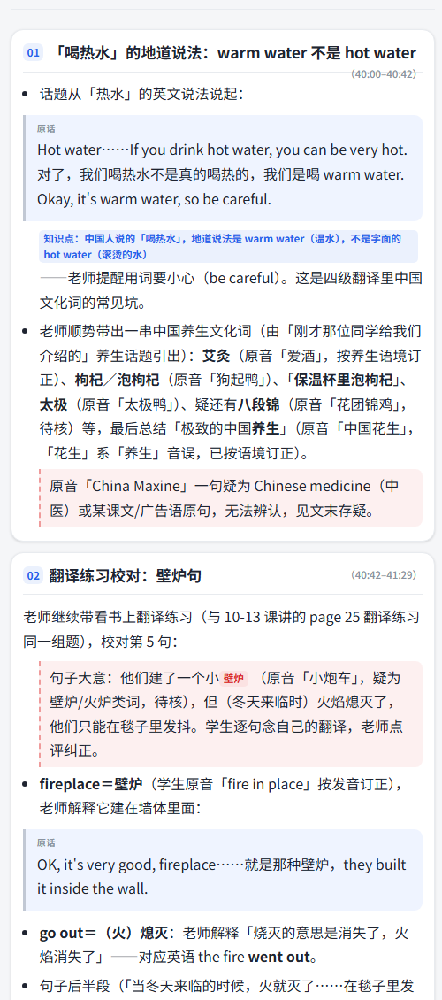

> 🚀 **v2.13（2026-10-26）**：作者日常在用的那一套「手机原生 APP + 自己电脑上的分析端」已完整开源——[`安卓APP/`](安卓APP/) 是原生 Kotlin 手机端源码，[`电脑端/`](电脑端/) 是电脑端现役代码，安装包挂在 [Releases](https://github.com/hxt7198302/class-notes/releases/latest)。看这一份就能跑起来。

> 📦 **合并版 v0.1（2026-10-24）**：与 Web 版合并后的公开脱敏快照在 [`merged-v0.1/`](merged-v0.1/)，含统一 Web UI、云端后端、电脑端能力模块与安卓 WebView 壳（这是另一条产品线，不是作者日常在用的手机原生 APP）。说明见 [merged-v0.1/README.md](merged-v0.1/README.md)。

# 课堂笔记 ClassNotes

> 上课只管录音、拍板书；下课回家，电脑自动把课变成能复看的笔记。
> **录音转写 + 板书照片按时间插进对应位置 + 自动抽出「老师布置的事」进待办。**
> 数据全在你自己电脑上，不注册账号、不上传云端。

ACC 2026 黑客松 · 赛道一（AI + 学习）· 队伍「阿泰与朝瑞」



---

## 为什么做它

大学课堂的真实痛点不是「没有录音」，而是：

- 录音 90 分钟，回放要 90 分钟 —— 找不到老师说「这道题」的那 30 秒；
- 板书拍了一堆照片，散在相册里，和录音对不上；
- 老师随口一句「下周三交实验报告」，期末才想起来。

已有产品的两条路都走不通：通用 AI 录音笔要上传云端（隐私 + 要钱），笔记软件要你下课自己整理（等于没用）。
课堂笔记选第三条：**手机只负责采集，重活在你自己的电脑上干，干完自动推回手机。**

## 现在能做什么

| 能力 | 说明 |
|---|---|
| 🎙 **上课录音** | 前台服务 + 独立录音进程，锁屏、切 App、划掉最近任务都不中断 |
| 📸 **拍板书** | 拍照即记下「第几分几秒」，出笔记时照片自动插进讲到这里的位置 |
| 📝 **自动转写** | 电脑端 faster-whisper（有 N 卡自动用 GPU），按 5 分钟分节，可点击跳回原音 |
| 🤖 **AI 整理**（可选） | 要点提炼、听不懂的地方配大白话、例题汇总、照片内容说明 |
| ✅ **待办自动抓取** | 从课堂原话里抽出作业/考试/报名/截止日期，进课程页倒计时 |
| 📶 **局域网 + 公网双通道** | 同一 WiFi 直连；不在家走 Cloudflare 免费隧道，地址自动同步，不用手填 |
| 🔄 **应用内更新** | 电脑端出新版，APP 里直接下载校验安装（sha256 校验后再交给系统安装器） |

## 三步用起来

**1. 电脑**：装 [Node.js](https://nodejs.org) LTS 和 [Python 3.10+](https://python.org)（勾 Add to PATH），
把 [cloudflared.exe](https://github.com/cloudflare/cloudflared/releases) 放到本目录，双击「启动电脑端.bat」。
首次会自动装转写引擎（几分钟，只装这一次）。

**2. 手机**：装 [`classnotes-v2.13.apk`](https://github.com/hxt7198302/class-notes/releases/download/v2.13/classnotes-v2.13.apk)（约 1.1 MB，Android 8.0 及以上；sha256 见 [releases/README.md](releases/README.md)）。也可以自己从 [`安卓APP/`](安卓APP/) 构建，步骤见下。

**3. 连接**（只做一次）：手机连**和电脑同一个 WiFi** → APP 点「🔗 第一次使用？点这里连接电脑」→「🔍 自动找我的电脑」。
（首次配对必须同一局域网：配对信息走 UDP 局域网发现。配好之后人在外面也能用隧道连回家。）

之后上课：点「开始上课」→ 要拍板书就拍照 → 下课点「下课」。回家笔记自动出现在 APP 里。

> ⚠️ 开源版源码**不内置任何配对口令**：token 在配对时由你的电脑生成并写进手机，每台机器都不同。

## 两种笔记模式

| 模式 | 需要 | 出什么 |
|---|---|---|
| **免费转写稿**（默认） | 什么都不用 | 课堂原话全文（每 5 分钟一节）+ 照片按时间插入 + 关键词抓的「可能要注意的事」 |
| **AI 整理**（推荐） | 一个免费 API Key | 要点提炼、大白话解释、重点标记、照片说明、作业/考试/报名进待办（带截止日期） |

AI 模式默认用智谱 `glm-4-flash`（免费额度，不扣费）。也支持硅基流动、Groq、本地 Ollama 等任何 OpenAI 兼容接口 —— 在 APP 设置里填 Key 和 baseUrl 即可。

## 架构

```
┌──────────── 手机 APP（Kotlin，零第三方依赖，minSdk 26） ────────────┐
│  Rec 前台服务（独立进程 :rec）→ 分片录音 3MB 续传                    │
│  PhotoActivity 拍照 → 记录时间戳                                     │
│  笔记 / 待办 / 课程页 ← 从电脑端拉 JSON + HTML                       │
└───────────────┬──────────────────────────────────────────────────────┘
                │ 同一 WiFi 直连  ／  Cloudflare 隧道（地址经 ntfy 广播）
┌───────────────▼──────── 你的电脑（Node 零依赖 + Python） ───────────┐
│  api-server/server.mjs   鉴权 / 上传续传 / 配对发现 / 版本更新        │
│  pipeline.mjs            转写 → 分析 → 生成笔记 HTML → 推送          │
│  engines.mjs             template（无 AI） / glm（OpenAI 兼容 API）  │
│  transcribe.py           faster-whisper，GPU 优先                    │
└──────────────────────────────────────────────────────────────────────┘
```

- **配对信任模型**：局域网内 UDP 发现 + 一次性 token，适合家庭/宿舍 WiFi；公共 WiFi 建议只用隧道模式。
- **续传**：上传按 3MB 分块、服务端按字节记录偏移，隧道抖动从断点继续，不重传整堂课。
- **隐私**：录音、照片、转写稿、笔记全部落在你电脑的 `素材/`、`笔记/` 目录；ntfy 只广播隧道网址，不含任何课堂内容。

## 从源码构建

**安卓**（Android Studio 或命令行均可，工程无第三方依赖）：

```bash
cd 安卓APP
# 需要 Android SDK Platform 34 + Build-Tools 34 + JDK 17 + Gradle 8.x（仓库未带 wrapper）
# 在 安卓APP/local.properties 里写一行：sdk.dir=你的 Android SDK 路径
# Windows 下用 Y:\sdk 这种盘符也可以；工程已开 android.overridePathCheck，中文路径能构建
gradle clean assembleDebug        # 发版必须 clean：增量构建出过 classes3.dex 膨胀的异常包
# 产物：安卓APP/app/build/outputs/apk/debug/app-debug.apk（用 Android 默认 debug 签名）
```

安装包与源码的对应关系：Releases 里的 `classnotes-v2.13.apk` 就是**这份源码**用 `clean assembleDebug` 构建的产物，versionCode 26，签名是 Android 默认 debug 证书（`981cde98…e6794`）。想自己签名就在 `app/build.gradle` 加 `signingConfigs`，换你自己的 key。

> v2.13 相对 2.12 只改了一处代码（`Api.connect()`）：开源版默认 token 是占位符，原来「先探活再保存凭证」会让空白安装永远配不上（拿占位 token 打 `/api/ping` 吃 401）。现在先把配对下发的 token 装进内存再探活，探通才落库。

**电脑端**：

```bash
# 零依赖：不需要 npm install
python -m pip install -r requirements.txt   # faster-whisper（首次会自动下模型）
copy 电脑端\config.example.json 电脑端\config.json   # 默认 engine=template：不填任何 AI Key 也能出转写稿笔记
node 电脑端/api-server/server.mjs
```

首次运行会在 `电脑端/` 下生成 `config.json` 与 `电脑端/api-server/api-token.txt`（都在 `.gitignore` 里）。
**别省掉复制配置那一步**：没有 `电脑端/config.json` 时服务端默认只监听 `127.0.0.1`，手机连不上（示例配置里是 `0.0.0.0`，并带局域网 UDP 发现）。
`engine` 可选项：`template`（默认，无 AI，零费用）/ `glm`（在 APP 里填免费 API Key 后自动切）/ `zcode`（作者私有的无头会话引擎，公开版用不到）。

## 路线图：把「记下来」升级成「讲懂你」

> 以下是**规划中的能力，当前版本尚未实现**。我们把它写在这里，是为了让评审和后来者看清方向，而不是假装已经做完。

在真实课堂里跑了一个多月、60+ 节课之后，我们确认下一块短板不是「记录」，而是**「课上没听懂的那一段，课后没人再讲一遍」**。

我们计划与 [清华 OpenMAIC](https://github.com/THU-MAIC/OpenMAIC)（MIT 协议的开源教育平台，本地已部署验证）打通：

1. **定位不懂的地方**：课堂笔记已经有逐句转写 + 时间轴 + 用户自己标记的重点/疑问；
2. **生成一段专属讲解**：把「这一段原话 + 课程上下文 + 本课课件」交给 OpenMAIC 的课程生成能力，产出针对这一段的讲解、例子和小测；
3. **回填到原位置**：讲解挂在那句转写旁边，点开就能听/看，不打断原有复习流；
4. **仍然本地优先**：模型可以跑在用户自己的电脑上，课堂数据不出机器。

已打通的底子：本地 OpenMAIC 部署与建课链路已跑通（用《地月轨道》做过完整课程 + 交互式模拟器）；课堂笔记的转写、时间轴、课程结构数据都已是结构化 JSON，具备对接条件。

**边界如实说**：这条联动目前只完成了两侧各自的验证，中间的自动生成与回填还没有写。它是本次比赛之后的第一步，不是已完成的功能。

## 已知限制

- 电脑端需要一台常开的 Windows / macOS / Linux 机器（转写吃 CPU/GPU，手机端做不了）；
- 安卓不允许普通应用静默安装，应用内更新的最后一步仍需用户点一下系统安装界面；
- 教室 WiFi 常开启设备隔离，跨网段时请走隧道模式；
- AI 整理的质量取决于模型，长课（>2 小时）会分段处理。

## 许可

MIT，见 [LICENSE](LICENSE)。faster-whisper / Whisper / Cloudflare 等依赖遵循各自协议。

## 团队

阿泰与朝瑞（黄兴泰 · 覃朝瑞）· ACC 2026 黑客松
